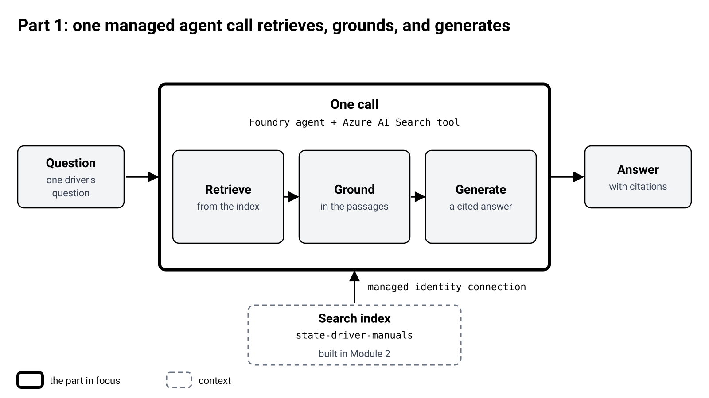
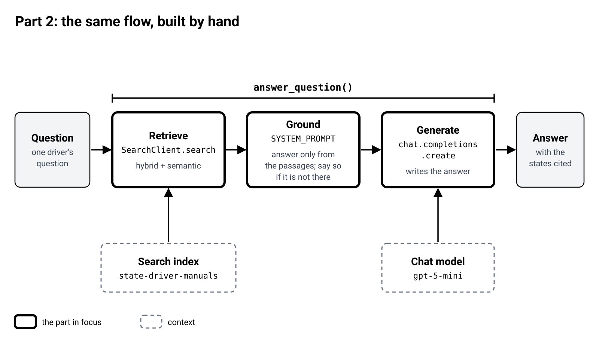
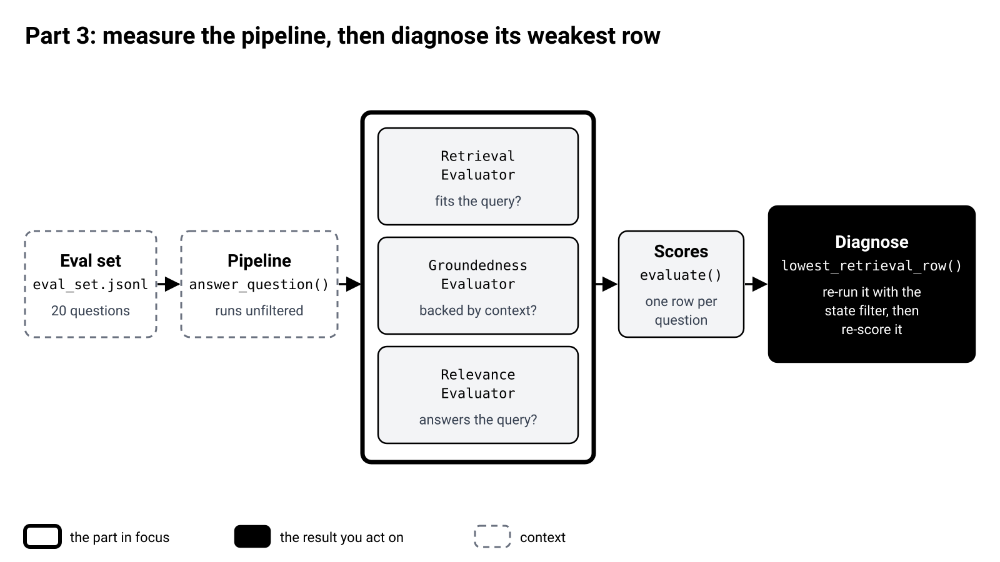

# Module 3: Grounded answers

Three parts, one goal each: one managed agent call, the same flow built by hand, and a way to measure it.

| File | What it is |
|---|---|
| `README.md` | This page: one diagram per part. |
| `helpers.py` | Pre-built functions. Each one wraps one SDK class or API. |
| `03_grounded_and_eval.ipynb` | The notebook. Fill in each `____` to build the part. |

## Part 1: one managed agent call retrieves, grounds, and generates

Goal: see that one Foundry agent call, with the Azure AI Search tool, does the whole job.

| Box | Class or API | One line |
|---|---|---|
| One call | `PromptAgentDefinition` with `AzureAISearchTool`, then `responses.create` | The agent retrieves passages from the index and writes a cited answer. |
| Connection | `project.connections.get(...)` | The Foundry project's connection to Search signs in with a managed identity. No API keys. |
| Search index | `index_name`, `query_type`, `top_k` | Which index, which kind of search to run, and how many passages to bring back. |

## Part 2: the same flow, built by hand

Goal: rebuild the three steps yourself so nothing is a black box.

| Box | Class or API | One line |
|---|---|---|
| Retrieve | `SearchClient.search`, `VectorizableTextQuery` | Hybrid and semantic search return the top passages. |
| Ground | `SYSTEM_PROMPT` | Answer only from the passages, cite the state, and say so when the answer is not there. |
| Generate | `chat.completions.create` | Writes the answer from the passages. |
| All three | `answer_question()` | Wraps the three steps in one function. |

## Part 3: measure the pipeline, then diagnose its weakest row

Goal: score 20 questions, then find and re-test the lowest retrieval row.

| Box | Class or API | One line |
|---|---|---|
| Eval set | `evaluate(data=...)` | 20 questions, each with an expected state and a ground truth. |
| Pipeline | `answer_question()` | Runs each question unfiltered. |
| Retrieval | `RetrievalEvaluator` | Scores how well the retrieved context fits the query. |
| Groundedness | `GroundednessEvaluator` | Scores whether the answer is backed by the context. |
| Relevance | `RelevanceEvaluator` | Scores whether the answer addresses the query. |
| Scores | `evaluate()` | Returns one row per question, plus an average for each metric. |
| Diagnose | `lowest_retrieval_row()` | Finds the lowest retrieval row. You re-run it with the state filter and re-score it. |
